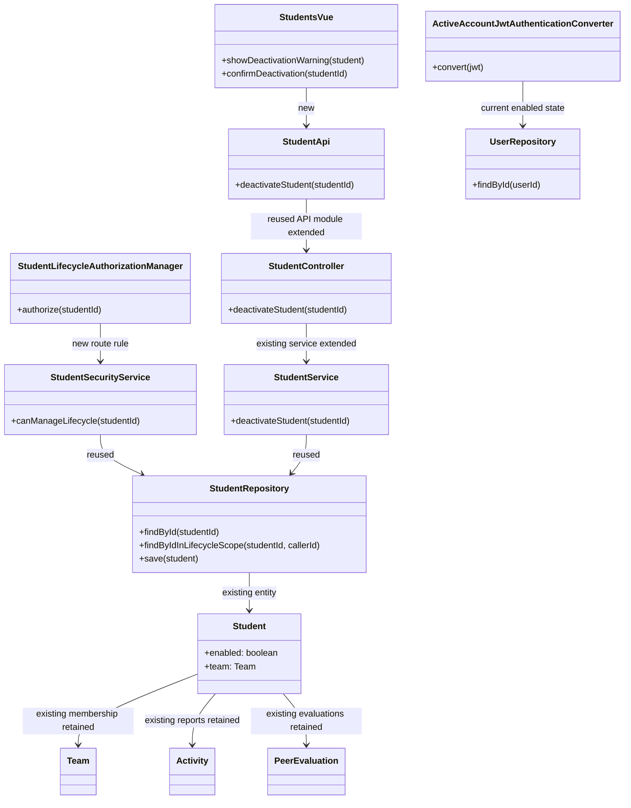

# Student Design

> Realizes: UC-STU-deactivate-student
> Depends on FRs: FR-SEC-active-account
> See: [use cases](../requirements/use-cases.md#uc-stu-deactivate-student-the-course-admininstructor-deactivates-a-student), [business rules](../requirements/business-rules.md#course-administration), [SRS](../requirements/software-requirements-specification.md), [architecture-of-record](architectural-design.md)

## Overview

The student area extends the existing `student` bounded context. Deactivation is a dedicated, instructor-facing action over the existing `Student.enabled` flag. It preserves the student row, team assignment, weekly activity reports, and peer evaluations. The UI asks for confirmation before calling the API. JWT authentication checks the account's current enabled state on every request so a token issued before deactivation stops granting access on its next protected request.

## Components & classes



`Students.vue` adds the row action and confirmation dialog; `apis/student` adds the API call. The existing edit form's status control cannot deactivate an active student; it remains available to enable an already-deactivated student, preserving the existing reactivation path without designing or building UC-STU-reactivate-student. `StudentController`, `StudentService`, `StudentSecurityService`, `StudentRepository`, `Student`, and `SecurityConfiguration` are reused and extended. A new `StudentAlreadyDeactivatedException`, its conflict mapping in `ExceptionHandlerAdvice`, a `StudentLifecycleAuthorizationManager`, and an `ActiveAccountJwtAuthenticationConverter` provide the explicit error and security behavior. There is no schema change.

## Sequence

### UC-STU-deactivate-student — Main success scenario

```mermaid
sequenceDiagram
    actor Instructor
    participant UI as Students.vue
    participant API as apis/student
    participant Sec as SecurityConfiguration
    participant Guard as StudentLifecycleAuthorizationManager
    participant Controller as StudentController
    participant Service as StudentService
    participant DB as StudentRepository

    Instructor->>UI: Choose Deactivate for a student (UC step 3)
    UI-->>Instructor: Show consequences and ask to confirm (UC step 4)
    Instructor->>UI: Confirm (UC step 5)
    UI->>API: POST /students/{studentId}/deactivate
    API->>Sec: Send authenticated request
    Sec->>Guard: Check course admin ownership or assigned instructor
    Guard-->>Sec: Authorized
    Sec->>Controller: Route request
    Controller->>Service: deactivateStudent(studentId)
    Service->>DB: Find active student; set enabled=false; save
    DB-->>Service: Updated student; team and submissions unchanged
    Service-->>Controller: Updated student
    Controller-->>API: 200 success
    API-->>UI: Success
    UI-->>Instructor: Show success and refresh student row (UC step 6)
```

### UC-STU-deactivate-student — Refusal, cancellation, and an existing session

```mermaid
sequenceDiagram
    actor Instructor
    actor Student
    participant UI as Students.vue
    participant API as apis/student
    participant Guard as StudentLifecycleAuthorizationManager
    participant Controller as StudentController
    participant Service as StudentService
    participant JWT as ActiveAccountJwtAuthenticationConverter
    participant Users as UserRepository

    Instructor->>UI: Choose Deactivate (UC step 3)
    UI-->>Instructor: Show warning (UC step 4)
    alt Instructor cancels (extension 4a)
        Instructor->>UI: Cancel
        UI-->>Instructor: Close warning; leave account unchanged
    else Instructor is not authorized (extension 1a)
        Instructor->>API: POST /students/{studentId}/deactivate
        API->>Guard: Check authority for studentId
        Guard-->>API: Denied
        API-->>Instructor: 403; no account change
    else Student is already deactivated (extension 3a)
        Instructor->>API: POST /students/{studentId}/deactivate
        API->>Controller: Authorized request
        Controller->>Service: deactivateStudent(studentId)
        Service-->>Instructor: 409; already deactivated
    end
    Note over Student,Users: If a previously issued JWT is used after deactivation (extension 6a), the converter reloads the account and rejects the request with 401 while disabled.
```

## API contract

| Endpoint | Caller (who may) | Request | Success | Errors, by extension |
|---|---|---|---|---|
| `POST /api/v1/students/{studentId}/deactivate` | Course admin owning the student's course or instructor assigned to the student's course section | Path `studentId`; no body | `200`, `Result` with the updated student DTO | 1a: `403`; missing, out-of-scope, or malformed student id: `403` (the route guard fails closed); 3a: `409` |

The warning and cancellation are client-side; Cancel sends no request.

## Key decisions

- Keep the student assigned to her current team. Removing her would change team membership and future report behavior; retaining membership preserves the record without restoring access.
- Make the dedicated row action the UI path that moves an active student to deactivated. The edit form's existing status control is disabled for active students but still lets an instructor re-enable an inactive one; removing that latter path would unnecessarily change the separate, out-of-scope reactivation flow.
- Keep the student in the section peer-evaluation report for every requested week, including weeks after deactivation, and allow active teammates to submit evaluations of her. The existing evaluator/evaluatee same-team check already permits this; `BR-submission-owed` excludes an inactive teammate from the set an active evaluator must rate. Hiding her or prohibiting ratings would discard useful team history and is rejected.
- Check enabled status whenever a JWT request is authenticated. Login-time validation alone leaves a previously issued token usable after deactivation, contrary to FR-SEC-active-account; a database-backed JWT converter rejects it on the next request. The same check applies to disabled instructors because the FR covers both account types.
- Restrict deactivation to the course admin who owns the student's course or an instructor assigned to her course section, as BR-student-lifecycle requires. A student may not deactivate herself through this administrative action.
- Reject a repeated deactivation with `409 Conflict` rather than silently succeeding. The explicit response tells the caller the selected action did not run again and leaves the record unchanged.

## Data model

No schema delta. Deactivation changes only the existing `Student.enabled` field. The existing `Student.team`, `Activity`, and `PeerEvaluation` associations remain intact; no row is deleted or rewritten.

## Reuse & cross-cutting

- Reuse the existing student entity, repository, student API module, team and section relationships, JWT roles, `UserRepository`, and `StudentSecurityService`.
- Check authorization twice: `StudentLifecycleAuthorizationManager` permits the course admin or assigned section instructor; the service then loads through `StudentRepository.findByIdInLifecycleScope(studentId, callerId)`. An unknown or out-of-scope id is refused by the route guard as `403`, matching the architecture's fail-closed rule.
- Extend `FR-SEC-active-account` enforcement at the JWT authentication boundary. The check reads the current `enabled` value rather than trusting the status captured in an earlier token.
- Leave peer-evaluation creation, section reports, and owed-item calculation unchanged; tests pin their current behavior for an inactive team member.

## Tests

| Use case, flow | Level (unit / integration) | Asserts |
|---|---|---|
| Main success scenario (steps 1–7) | Backend integration + Cypress | An authorized instructor deactivates an active student; the dedicated UI action shows the warning, confirmation sends the request, the row updates, and the stored enabled flag becomes false. |
| Main success scenario — dedicated action boundary | Cypress | An active student's legacy status control is disabled; only the dedicated row action starts deactivation. |
| Main success scenario — retained records (Associated Information) | Backend integration | Team assignment, prior weekly activity reports, and prior peer evaluations remain after deactivation. |
| Extension 1a — actor is neither the course admin nor an assigned instructor | Backend integration | The request is refused with 403 and the student's account remains active. |
| Extension 3a — account is already deactivated | Backend integration | A repeated request returns 409 and does not alter team membership or records. |
| Extension 4a — instructor cancels at the warning | Cypress | The dialog closes, no API request is sent, and the student remains active. |
| Extension 6a — student holds a token issued before deactivation | Backend integration | The token works before deactivation and receives 401 on the next protected request afterward. |
| Associated Information — inactive teammate and evaluation report | Backend integration | An active teammate can submit a peer evaluation of the inactive student; the section report includes her for each requested week after deactivation; the active evaluator is not required to evaluate her under BR-submission-owed. |

## Open questions / risks

The request-time enabled check adds one user lookup to JWT-authenticated requests. This is required for FR-SEC-active-account; if the user store is unavailable, authentication must fail closed. No database migration is needed.
